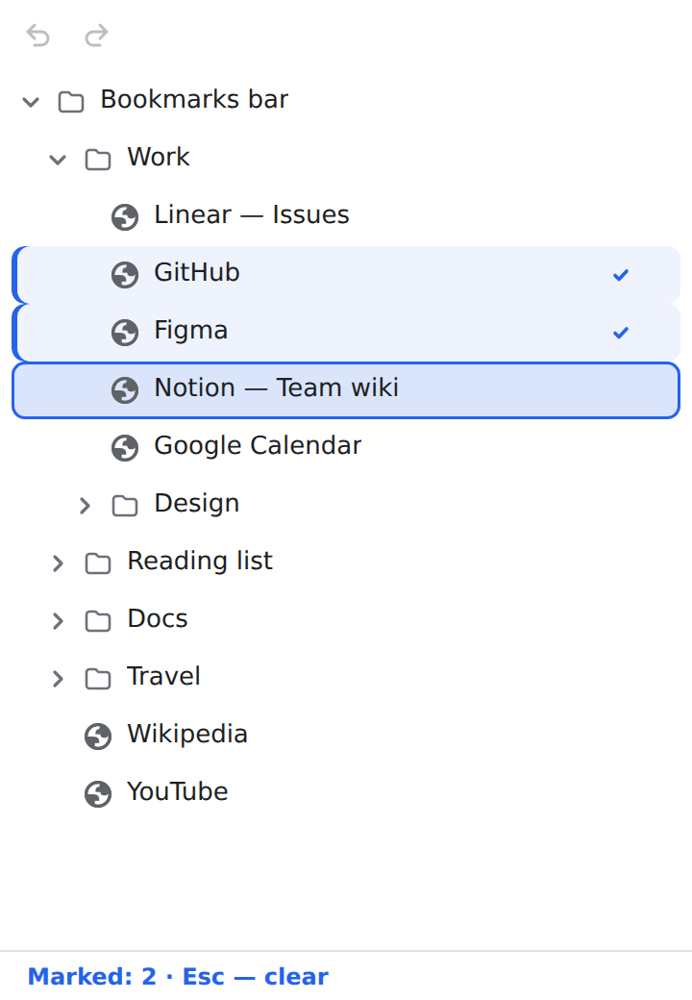

# Airnook Bookmarks

[🇬🇧 English](../../.github/README.md) | [🇷🇺 Русский](../ru/README.md) | [🇪🇸 Español](../es/README.md) | [🇧🇷 Português (Brasil)](../pt-BR/README.md) | [🇫🇷 Français](../fr/README.md) | **🇩🇪 Deutsch** | [🇨🇳 中文（简体）](../zh-CN/README.md) | [🇯🇵 日本語](../ja/README.md) | [🇮🇳 हिन्दी](../hi/README.md) | [🇸🇦 العربية](../ar/README.md)

[](https://github.com/Airnook/bookmarks/actions/workflows/ci.yml)
[](https://github.com/Airnook/bookmarks/releases/latest)
[](https://www.chromium.org/)
[](https://developer.chrome.com/docs/extensions/develop/migrate/what-is-mv3)
[](TRANSLATING.md)
[](../../LICENSE)

**Lesezeichen** ist eine Erweiterung für Chromium-Browser (Chrome, Edge, Brave, Arc, Helium und andere): Ihre Lesezeichen
in der Seitenleiste, neben der Seite, alles per Tastatur. Finden, öffnen, in Ordnern sortieren, Lesezeichen als
angepinnte Tabs behalten. Entstanden beim Umstieg von Arc auf einen Chromium-Browser: Dessen Seitenleiste fehlte.

<p align="center">
  <picture>
    <source media="(prefers-color-scheme: dark)" srcset="../panel-dark.png">
    
  </picture>
</p>

## Inhalt

- [Funktionen](#funktionen)
- [Installation](#installation)
- [Schnellstart](#schnellstart)
- [Standardtasten](#standardtasten)
- [Datenschutz](#datenschutz)
- [Übersetzungen](#übersetzungen)
- [Entwicklung](#entwicklung)
- [Lizenz](#lizenz)

## Funktionen

- ⌨️ **Ein Tastenkürzel für die Seitenleiste**: `Alt+B` (`⌥B` auf dem Mac) öffnet die Seitenleiste, holt den Fokus von
  der Seite zurück und schließt sie. Ändern lässt es sich unter `chrome://extensions/shortcuts`.
- 📌 **Lesezeichen als angepinnte Tabs**, wie in Arc: ein Punkt bei Lesezeichen mit offenem Tab (und ein Ring bei einem
  zugeklappten Ordner, in dem etwas offen ist). Erneutes Öffnen wechselt zum Tab des Lesezeichens, `Shift+Enter` setzt
  den Tab auf die Adresse des Lesezeichens zurück, `U` speichert die aktuelle Adresse im Lesezeichen. Der Modus lässt
  sich in den Einstellungen ausschalten.
- 🔎 **Suche**: `/` oder `⌘F`/`Ctrl+F`, nach Titel, Adresse und Ordner, mit Hervorhebung. `Tab` zeigt den Treffer an
  seiner Stelle im Baum.
- 🗂️ **Lesezeichen sortieren**: Markierungen (`Leertaste`, `Shift+↑↓`, `⌘A`), in einen Ordner nach Namen verschieben
  (`M`, zuletzt benutzte Ordner zuerst; fehlt der Ordner, wird er angelegt), in der Liste verschieben (`Alt+↑↓`), neuer
  Ordner (`N`), umbenennen (`R`), löschen (`D`), Adressen kopieren (`C`).
- ↩️ **Rückgängig machen und wiederholen** (neu in 2.6): `⌘Z` / `⌘⇧Z` auf dem Mac, sonst `Ctrl+Z` und `Ctrl+Shift+Z`
  oder `Ctrl+Y`, oder die Schaltfläche „Rückgängig“ in der Meldung. Ein gelöschter Ordner kommt mit seinem Inhalt
  zurück. Der Verlauf umfasst 50 Schritte und gilt für alle Fenster, bis der Browser geschlossen wird.
- 🖱️ **Ziehen und Ablegen** (neu in 2.6): Lesezeichen, Ordner und Markiertes lassen sich mit der Maus darüber, darunter
  oder in einen Ordner ziehen. Ein Ordner öffnet sich, wenn man ein Element darüber hält, und die Liste scrollt am Rand.
- 📋 **Rechtsklickmenü** (neu in 2.6), wie das Lesezeichenmenü des Browsers: in neuem Tab, neuem Fenster, geteilter
  Ansicht oder Inkognitofenster öffnen; bearbeiten; ausschneiden, kopieren und einfügen; löschen; Seite oder Ordner
  hinzufügen; Lesezeichenmanager öffnen. Per Tastatur: `Shift+F10`.
- 📂 **Als Gruppe öffnen**: markierte Lesezeichen oder einen ganzen Ordner, als benannte Tabgruppe oder als normale
  Tabs. Bereits geöffnete Tabs werden nicht doppelt geöffnet.
- 🎛️ **Befehlspalette**: `⌘K`/`Ctrl+K` oder `?` – alle Befehle mit ihren Tasten.
- 🔧 **Eigene Tasten**: Jeder Befehl lässt sich in den Einstellungen neu belegen. Es gibt eine Vim-Belegung, Folgen
  (`G G`) und doppeltes Drücken. Tasten werden nach ihrer Position erkannt und funktionieren daher mit jedem
  Tastaturlayout.
- 👁️ **Ansicht**: `V` wechselt zwischen normal, mit Adresse unter dem Titel und kompakt.
- ⚙️ **Einstellungen**: Startordner, Lesezeichen in neuem Tab öffnen, Lesezeichen als angepinnte Tabs, Seitenleiste
  schließen, wenn der Fokus auf die Seite wechselt.
- 🌍 **10 Sprachen** mit Unterstützung für Schrift von rechts nach links; die eingebaute Hilfe (`i`) beschreibt alle
  Abläufe.

## Installation

**Über GitHub Release**

1. Laden Sie `airnook-bookmarks-<version>.zip` aus dem [neuesten Release](https://github.com/Airnook/bookmarks/releases/latest) herunter.
2. Entpacken Sie das Archiv in einen dauerhaften Ordner: Der Browser liest die Erweiterung von dort.
3. Öffnen Sie `chrome://extensions` und schalten Sie den „Entwicklermodus“ ein.
4. Klicken Sie auf „Entpackte Erweiterung laden“ und wählen Sie den Ordner mit `manifest.json`.
5. Zum Aktualisieren ersetzen Sie die Dateien im selben Ordner und klicken auf der Karte der Erweiterung auf „Neu laden“.

**Chrome Web Store**: demnächst.

Chromium 141 oder neuer wird benötigt.

## Schnellstart

1. `Alt+B` – Seitenleiste öffnen. Erneut drücken schließt sie; ist der Fokus auf die Seite gewechselt, holt dasselbe
   Kürzel ihn in die Seitenleiste zurück. Auch das Symbol der Erweiterung öffnet die Seitenleiste – pinnen Sie es im
   Erweiterungsmenü des Browsers an.
2. `↑` `↓` – durch die Liste, `→` `←` – Ordner auf- und zuklappen, `Enter` – öffnen.
3. `/` – Suche: Titel, Website oder Ordner eintippen.
4. `Leertaste` – mehrere Lesezeichen markieren, `M` – sie nach Namen in einen Ordner verschieben.
5. `⌘K`/`Ctrl+K` – Befehlspalette: alle Befehle mit ihren Tasten.
6. Rechtsklick auf ein Lesezeichen, einen Ordner oder eine freie Stelle öffnet ein Menü wie im Browser; `Shift+F10` –
   dasselbe per Tastatur.
7. `i` – Hilfe. Neue Lesezeichen fügen Sie wie im Browser üblich hinzu – `⌘D`/`Ctrl+D`.

## Standardtasten

`⌘` entspricht `Ctrl` unter Windows und Linux. Jede Taste lässt sich in den Einstellungen ändern.

| Aktion | Tasten |
| --- | --- |
| Durch die Liste / Ordner auf-, zuklappen | `↑` `↓` / `→` `←`, `Home` `End` |
| Öffnen / in anderem Tab öffnen | `Enter` / `⌘Enter` |
| Tab auf Adresse des Lesezeichens zurücksetzen | `Shift+Enter` |
| Lesezeichen durchsuchen | `/`, `⌘F` |
| Befehlspalette | `⌘K`, `?` |
| Menü öffnen | `Shift+F10` |
| Markieren / fortlaufend / alles im Ordner markieren | `Leertaste` / `Shift+↑↓` / `⌘A` |
| In Ordner verschieben… / nach oben, unten verschieben | `M` / `Alt+↑↓` |
| Neuer Ordner, umbenennen, löschen | `N`, `R` (`F2`), `D` |
| Adresse kopieren / Adresse des Tabs speichern | `C` / `U` |
| Ausschneiden, kopieren, einfügen | `⌘X`, `⌘C`, `⌘V` |
| Rückgängig machen / wiederholen | `⌘Z` / `⌘⇧Z`, `⌘Y` |
| Tab des Lesezeichens schließen | `⌫`, `Delete` |
| Ansicht wechseln / Hilfe / Einstellungen | `V` / `i` (`F1`) / `,` |
| Abbrechen oder schließen: Markierungen aufheben, Suche verlassen, Seitenleiste schließen | `Esc` |

## Datenschutz

Die Erweiterung arbeitet nur lokal und sendet nichts ins Netz: Weder Ihre Lesezeichen noch Ihr Verlauf verlassen den
Browser. Die Einstellungen liegen im lokalen Speicher der Erweiterung im Browser. Berechtigungen werden für
Lesezeichen, die Seitenleiste, Website-Symbole, Tabs und Tabgruppen (Modus der angepinnten Tabs und Öffnen als Gruppe)
und zum Speichern der Einstellungen benötigt.

## Übersetzungen

Oberfläche und Hilfe folgen der Sprache des Browsers: English, Русский, Español, Português (Brasil), Français, Deutsch,
中文（简体）, 日本語, हिन्दी, العربية. Für andere Sprachen wird Englisch verwendet.

Möchten Sie Ihre Sprache hinzufügen oder eine Übersetzung korrigieren? Siehe [TRANSLATING.md](TRANSLATING.md) (auf
Englisch) oder öffnen Sie ein [Issue „Translation“](https://github.com/Airnook/bookmarks/issues/new?template=translation.yml).

## Entwicklung

Reines JavaScript (Manifest V3) ohne Build-Schritt: Der Browser lädt die Dateien aus dem Wurzelverzeichnis des
Repositorys so, wie sie sind.

```sh
npm ci
npm run lint
npm test
npm run test:browser   # Smoke-Test in Chromium: npx playwright install chromium
npm run package        # dist/airnook-bookmarks-<version>.zip
```

Architektur, Tests und der Release-Ablauf sind in [CONTRIBUTING.md](CONTRIBUTING.md) beschrieben.

## Lizenz

[MIT](../../LICENSE) © 2026 Airnook
